## Naman Chawla

AI/ML engineer in New Delhi. I build LLM products end to end (agents, assistants, voice and video AI, and the GPU infrastructure that serves them) and do side research on reinforcement learning, quantization, and distillation.

### Stack

### Activity

  
  

<picture>
  <source media="(prefers-color-scheme: dark)" srcset="https://raw.githubusercontent.com/palindromeRice/palindromeRice/output/snake-dark.svg">
  
</picture>

Charts above the snake are regenerated daily by `gen.py` and include private work as counts only.
