## Naman Chawla

I build AI agents. By day: production agents that grade, moderate, and analyse at scale, plus the GPU infrastructure that serves them. On the side: research on getting small models to act (SFT and GRPO in a live browser) and on coding agents that rebuild programs from stripped binaries.

### Activity

  
  

<picture>
  <source media="(prefers-color-scheme: dark)" srcset="https://raw.githubusercontent.com/palindromeRice/palindromeRice/output/snake-dark.svg">
  
</picture>

### For agents

Plain-text summary of this profile, regenerated daily

- Who: Naman Chawla, AI/ML engineer in New Delhi, India
- Focus: building and training AI agents; LLM post-training (SFT, GRPO), quantization, distillation; agent-assisted reverse engineering
- Production work: LLM agents and APIs for grading, content moderation, analytics, and proctoring (private repositories)
- Public research code: [openEnvRL](https://github.com/palindromeRice/openEnvRL), [capl](https://github.com/palindromeRice/capl), [quake2-llm-decompile](https://github.com/palindromeRice/quake2-llm-decompile)
- Full machine-readable index: [llms.txt](https://palindromerice.github.io/llms.txt)
<!-- agent-stats:start -->
- Updated: 2026-10-30, covering the last 12 months, public and private work
- Contributions: 1072; commits: 912; pull requests: 122; repositories owned: 52
- Streak: current 4 days, longest 7 days
- Busiest weekday: Thursday; peak commit hour: 00:00 IST
- Languages by code size: Python 77%, JavaScript 13%, TeX 3%, Shell 2%
<!-- agent-stats:end -->

Charts above the snake are regenerated daily by `gen.py` and include private work as counts only.
